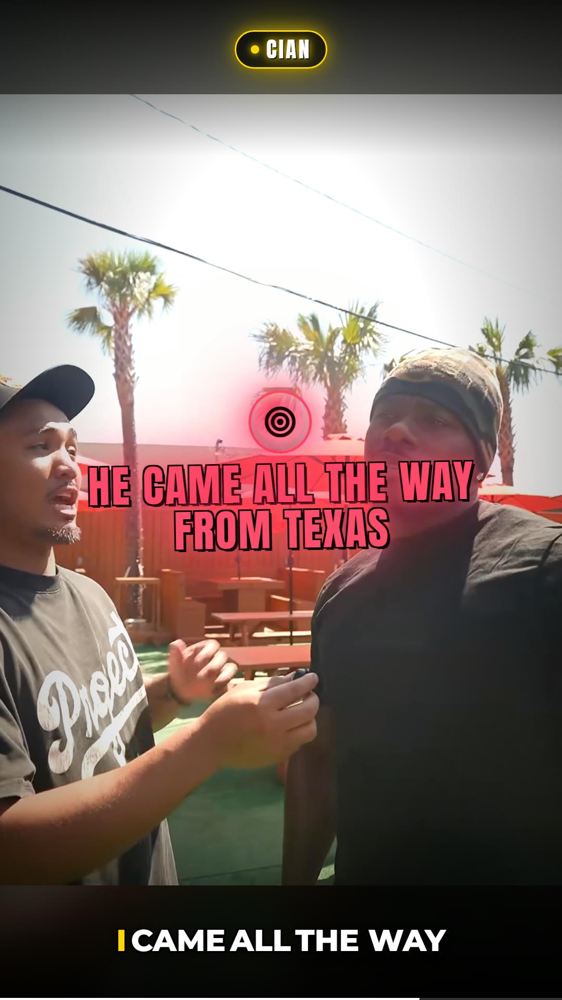
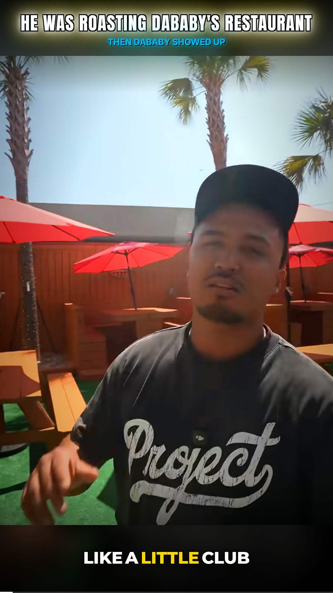
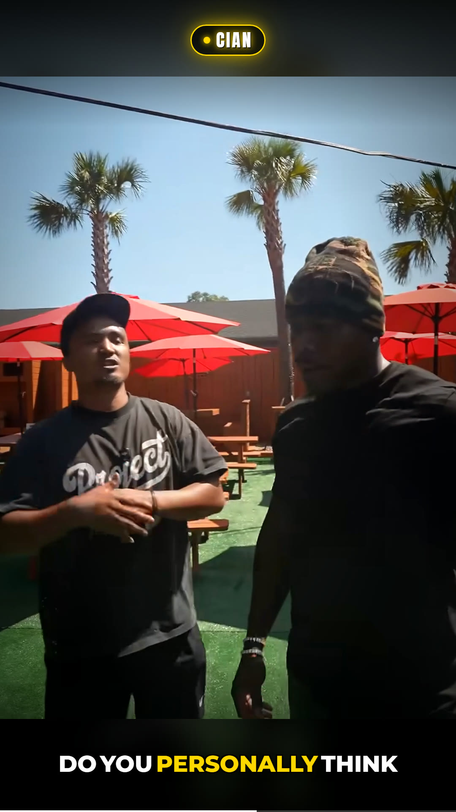
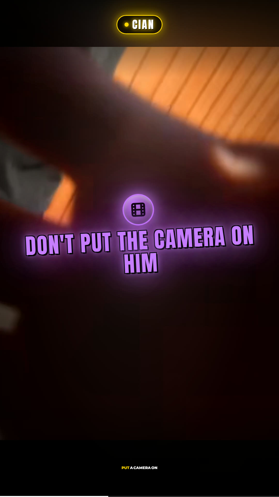

<div align="center">

# Shorts Production Standard

**A 9:16 house style your agent can follow.**

by [Sajeeb Sarker](https://github.com/Sajeebsarker123) · [Omniedit X Studio](https://github.com/omnieditxstudio-IT)

One `SKILL.md`. No dependencies. Read it before the render.

[](LICENSE)




<sub>Frames from a demo short built with this standard.</sub>

</div>

A drop-in production standard for **YouTube Shorts, TikTok and Instagram Reels**.
It keeps every vertical cut consistent — captions, badge, punch-ins, colour and
final QA — whether you render with Remotion, FFmpeg or an editor.

## What it enforces

- **1080×1920 at 30 fps**, one active audio source.
- **2.5× centred source** — `1.0` only when the whole frame is requested.
- **Bold ALL-CAPS captions** — word-synced subtitles, yellow active word, black outline, above the controls.
- **One badge** top-centre after the hook. Glow only on centred payoff labels.
- **Restrained motion** — punch-ins on real beats, white flash on hard cuts, gold only on the win.
- **Clean captions** — no `>>` markers, names and amounts fixed from context.
- **Restrained grade** in a separate `_cc` master: exposure `+0.04`, contrast `1.08`, saturation `1.07`, gamma `1.02`.

## Install

```bash
# OpenCode — macOS / Linux
git clone https://github.com/omnieditxstudio-IT/shorts-production-standard.git \
  ~/.config/opencode/skills/shorts-production-standard
```

```powershell
# OpenCode — Windows
git clone https://github.com/omnieditxstudio-IT/shorts-production-standard.git "$env:USERPROFILE\.config\opencode\skills\shorts-production-standard"
```

**Claude Code** reads `~/.claude/skills/` — clone there instead.
**Any other agent** — point it at `SKILL.md` or paste the file into the session.

## Use

> Cut a 45-second short from this video. Follow the shorts-production-standard.

That is the whole workflow. The skill fires on Shorts, TikTok, Reels and any 9:16 export.

## What it looks like

| Hook | Captions | Label |
|:---:|:---:|:---:|
|  |  |  |
| opening hook | yellow active word + badge | centred payoff label |

## Verify before you post

```bash
python scripts/verify.py out/short.mp4
```

Checks `1080×1920`, `30 fps`, H.264, AAC and a real duration. Exits non-zero if the file is not delivery-ready.

## Works with

OpenCode · Claude Code · Codex · Cursor — anything that can read a file.

Tool-agnostic by design: it pairs with Remotion, FFmpeg, CapCut or a manual edit, and drops into automated pipelines.

## Author

Built by [Sajeeb Sarker](https://github.com/Sajeebsarker123) at [Omniedit X Studio](https://github.com/omnieditxstudio-IT). Issues and PRs welcome.

## License

MIT. See [LICENSE](LICENSE). Preview footage credit: [CREDITS.md](CREDITS.md).
